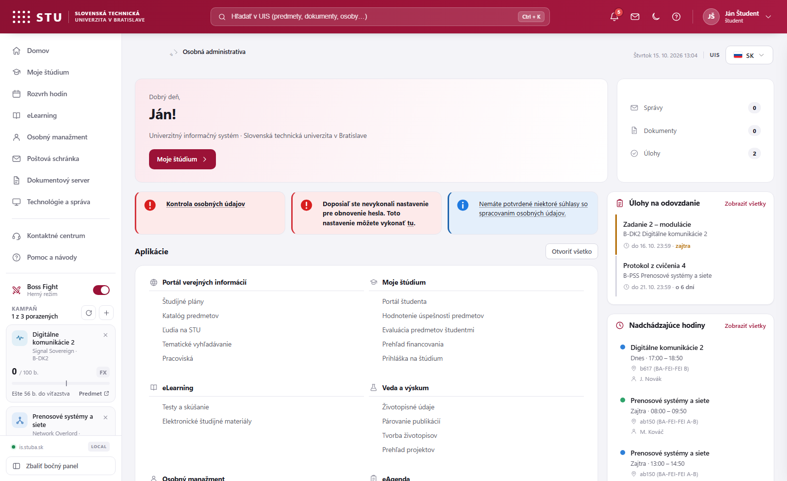
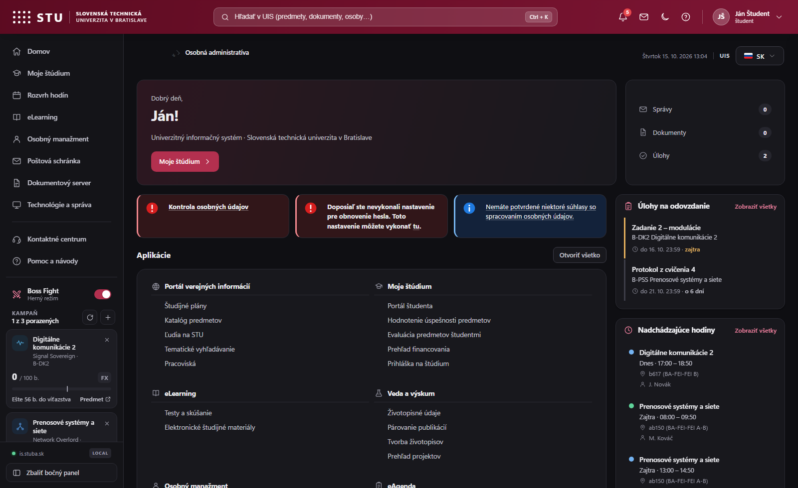
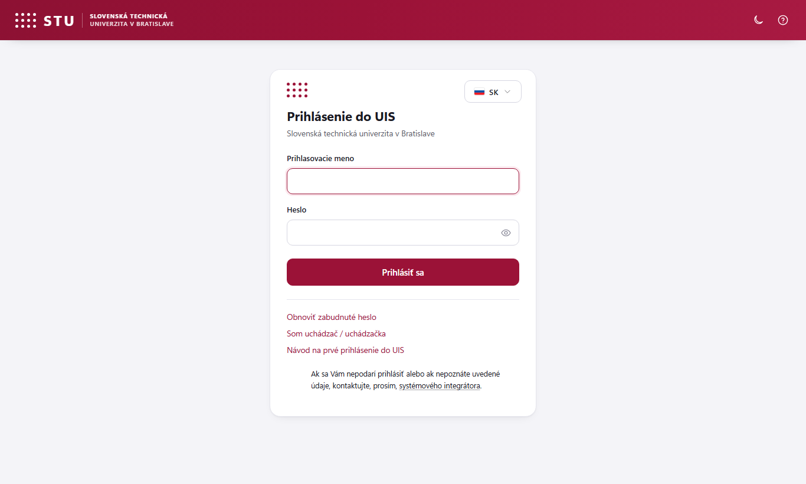
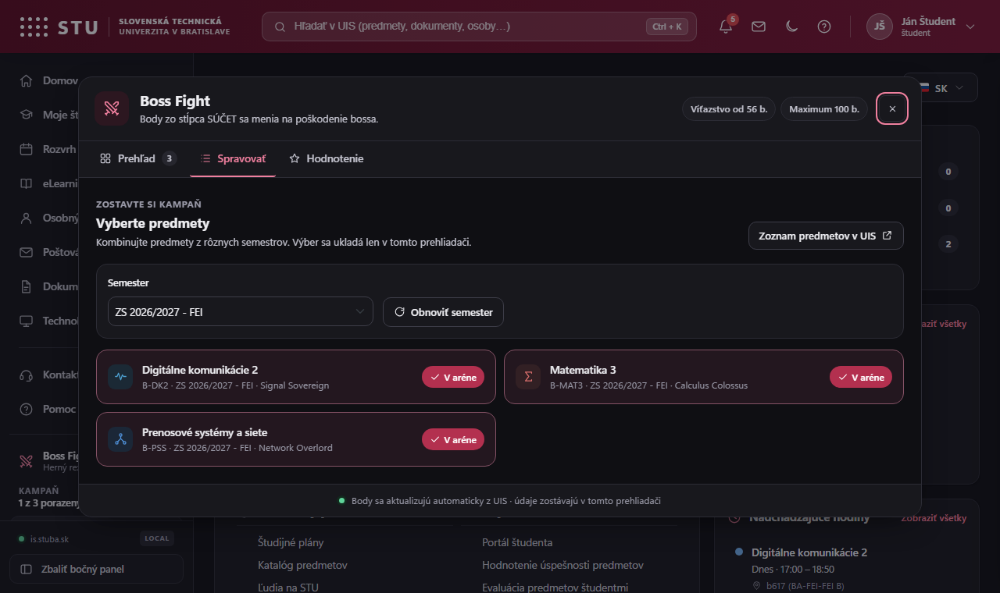

<div align="center">
  
  <h1>UIS+</h1>
  <p><strong>A modern interface for STU UIS — the university information system at is.stuba.sk.</strong></p>
  <p>
    A clean sign-in, a sidebar built from your own menu, a rebuilt weekly timetable, assignments due,<br>
    a command palette and a readable dark theme for students of the Slovak University of Technology
    in Bratislava. Formerly AIS+.
  </p>

  <p>
    <a href="https://github.com/antehor/UIS-Plus/releases/latest"><strong>Download UIS+</strong></a>
    ·
    <a href="#installation">Installation</a>
    ·
    <a href="#features">Features</a>
    ·
    <a href="#frequently-asked-questions">FAQ</a>
    ·
    <a href="#slovenčina">Slovenčina</a>
    ·
    <a href="https://github.com/antehor/UIS-Plus/issues">Report a problem</a>
  </p>

  <p>
    <a href="https://github.com/antehor/UIS-Plus/releases/latest"></a>
    <a href="https://github.com/antehor/UIS-Plus/releases"></a>
    <a href="https://github.com/antehor/UIS-Plus/actions/workflows/check.yml"></a>
    <a href="LICENSE"></a>
    
    
    
  </p>
</div>

---

> [!IMPORTANT]
> **UIS+ is the new name of AIS+.** STU now calls the system **UIS — Univerzitný informačný
> systém** (University Information System). If you used **AIS+**, searched for **STU AIS**, or know
> the old **Akademický informačný systém**, this is the same extension and the same `is.stuba.sk`
> service, updated for the new UIS name. Existing settings remain compatible.

**UIS+** is an open-source Chrome and Microsoft Edge extension that modernizes
[`is.stuba.sk`](https://is.stuba.sk/) for students of the
[Slovak University of Technology in Bratislava (STU)](https://www.stuba.sk/). It restyles the real
STU pages instead of replacing them, so every form, link, session and server response stays exactly
as the university serves it.



## Contents

- [What's new in 3.0.1](#whats-new-in-301)
- [Why UIS+](#why-uis)
- [Features](#features)
- [Installation](#installation)
- [Updating](#updating)
- [Using UIS+](#using-uis)
- [Keyboard shortcuts](#keyboard-shortcuts)
- [Privacy and permissions](#privacy-and-permissions)
- [How it works](#how-it-works)
- [Compatibility](#compatibility)
- [Frequently asked questions](#frequently-asked-questions)
- [Slovenčina](#slovenčina)
- [Contributing](#contributing)

## What's new in 3.0.1

- **Sign-in page fixed.** The login form no longer disappears under the dashboard; it gets its own
  card with labelled fields, a show/hide password toggle and password-manager support.
- **Assignments due.** "Úlohy" now counts the open submission places from the student portal
  (*Miesta odovzdania*) and lists what is still due, with the time left.
- **Unread mail stands out** in both themes.
- **Readable dark theme**, an aligned applications directory on the home page, and a redesigned,
  localized Boss Fight.

See the full [changelog](CHANGELOG.md).

## Why UIS+

| Standard STU UIS workflow | With UIS+ |
|---|---|
| Study tools are spread across several nested menus | A persistent sidebar built from your own live UIS menu |
| The timetable is a wide day-per-row table | A vertical week grid with colour-coded lectures and seminars |
| Deadlines hide inside the student portal | Assignments due appear on the home page with the time left |
| Reaching an application takes several clicks | `Ctrl + K` opens a command palette over every UIS application |
| A long wall of module boxes on the home page | One aligned applications directory with line icons |
| One fixed visual style | Light, dark and system themes, plus a compact density |
| Navigation language can change between pages | Your reading language is carried through every link |

## Features

### Navigation

- **Sidebar built from the live UIS menu.** Destinations are read from the personal administration
  page of your own signed-in session and cached locally, so no student-specific URL is hard-coded.
  The collapse button stays pinned to the bottom.
- **Command palette** (`Ctrl + K`) that searches every UIS application, the UIS+ sections and the
  links on the current page.
- **Counters** for unread messages, new documents and tasks, with a notification drawer.

### Rebuilt applications

- **Sign-in.** A focused login card: labelled fields, a show/hide password toggle, password-manager
  hints and the language picker. Nothing else is drawn until you are signed in.
- **Home.** A greeting header, notice cards grouped by severity, an aligned applications directory,
  your **assignments due** and your **next lessons** in the side rail.
- **Timetable.** The native day-per-row table is parsed and re-rendered as a vertical week grid:
  day columns, the current day highlighted, colour-coded lectures and seminars, room and teacher
  lines, an upcoming-lessons list, per-course filters and a local `.ics` export.
- **Mailbox and document server.** A two-column layout with the folder tree, mailbox quota and
  legend beside a full-width listing; unread messages are clearly marked.
- **Message view.** The message itself beside a rail with the sender, message details and
  attachments.

### Interface

- **Light, dark and system themes**, tuned for contrast, plus an optional compact density.
- **English, Slovak and Czech** interface controls, or `Auto` to follow the page.
- **Real STU UIS functionality stays intact** — UIS+ restyles existing pages and never replaces
  STU forms, links, sessions or server responses.
- **Optional Boss Fight mode** turns your semester score (`SÚČET`) into a private, local game layer
  using the STU grading scale.

<details>
<summary><strong>Show the dark theme</strong></summary>



</details>

<details>
<summary><strong>Show the sign-in page</strong></summary>



</details>

## Installation

### Google Chrome

1. Download `UIS-plus-v3.0.1.zip` from the
   [latest release](https://github.com/antehor/UIS-Plus/releases/latest).
2. Extract the archive to a permanent folder.
3. Open `chrome://extensions`.
4. Enable **Developer mode**.
5. Select **Load unpacked** and choose the extracted folder containing `manifest.json`.
6. Open or reload [is.stuba.sk](https://is.stuba.sk/).

### Microsoft Edge

1. Download and extract the latest UIS+ release.
2. Open `edge://extensions` and enable **Developer mode**.
3. Select **Load unpacked** and choose the folder containing `manifest.json`.
4. Open or reload [is.stuba.sk](https://is.stuba.sk/).

> Keep the extracted folder in place after installation. For more detail, open
> [`INSTALL.html`](INSTALL.html) or read the [installation guide](docs/INSTALLATION.md).

<details>
<summary><strong>Install from source</strong></summary>

```bash
git clone https://github.com/antehor/UIS-Plus.git
```

Load the cloned `UIS-Plus` directory as an unpacked extension. UIS+ has no build step and requires
no package manager.

</details>

## Updating

1. Download the latest release and extract it over the existing extension folder.
2. Open `chrome://extensions` or `edge://extensions` and press **Reload** on the UIS+ card.
3. Refresh the `is.stuba.sk` tab.

UIS+ is a direct continuation of AIS+, and the storage keys are unchanged, so themes, language,
compact mode, sidebar state and Boss Fight data remain available after updating.

## Using UIS+

- Click the **UIS+ extension icon** to enable or disable the redesign and choose a theme, language
  or density.
- Use the **moon and sun button** in the top bar to switch between light and dark.
- Use the **flag button** in the breadcrumb bar to switch between `SK`, `CZ` and `EN`.
- Use **Collapse sidebar** at the bottom of the navigation rail to shrink it to icons.
- Open the **timetable once** so the home page can list your next lessons; the events are cached
  locally in the browser.
- **Assignments due** refresh on their own when you open the home page (at most every ten minutes)
  or the *Miesta odovzdania* tab.
- Enable **Boss Fight** only if you want the optional local game layer; see
  [Boss Fight documentation](docs/BOSS-FIGHT.md).

<details>
<summary><strong>Preview Boss Fight</strong></summary>




</details>

## Keyboard shortcuts

| Shortcut | Action |
|---|---|
| `Ctrl + K` | Open the command palette |
| `Ctrl + [` | Collapse or expand the sidebar |
| `↑` `↓` | Move through palette results |
| `Enter` | Open the selected result |
| `Esc` | Close the palette, drawer, dialog or mobile menu |

## Privacy and permissions

UIS+ runs entirely in your browser and talks to nothing but `is.stuba.sk`.

- It **never reads, stores or sends your password**; the sign-in form is submitted by STU's own
  page, exactly as without the extension.
- To show assignments due and Boss Fight scores it **reads a few student-portal pages from
  `is.stuba.sk`** inside your own signed-in session — the same pages you could open yourself. It
  never submits a form or changes anything in UIS.
- Everything it keeps — preferences, the discovered menu, cached timetable events, assignments and
  Boss Fight data — stays in the browser's extension storage on this device.
- There is no analytics, no remote server and no third-party request.

| Permission | Why it is needed |
|---|---|
| `storage` | Keeps your theme, language, density, sidebar state and local caches on this device |
| `https://is.stuba.sk/*` | The only site the extension is allowed to touch |

No `tabs`, no host access beyond `is.stuba.sk`, no background worker. See the full
[privacy policy](PRIVACY.md).

## How it works

UIS+ is a Manifest V3 content script that runs on `is.stuba.sk`:

| File | Responsibility |
|---|---|
| `styles.css` | Design tokens (light and dark), native chrome reset and the application shell |
| `components.css` | Restyles the STU markup: breadcrumbs, tabs, tables, notices, forms, sign-in |
| `pages.css` | Layouts for individual applications, such as the timetable grid |
| `content.js` | Builds the topbar, sidebar, breadcrumb bar, command palette and drawer |
| `pages.js` | Parses and rebuilds individual applications from the served markup |
| `boss-fight.js` / `boss-fight.css` | The optional local game layer |

Everything rendered comes from pages STU serves to you; nothing is invented.

## Compatibility

| Browser | Status |
|---|---|
| Google Chrome (current) | Supported |
| Microsoft Edge (current) | Supported |
| Other Chromium browsers (Brave, Opera, Vivaldi) | Expected to work; not officially tested |
| Firefox | Not packaged yet |

## Frequently asked questions

### Is UIS+ an official STU product?

No. UIS+ is an independent open-source project. It is not affiliated with, endorsed by or operated
by the Slovak University of Technology in Bratislava.

### Does UIS+ see my password or my grades?

UIS+ never touches your password. It reads your assessment page only if you turn on Boss Fight,
and the student-portal submission list to count assignments due; both are read inside your own
session from `is.stuba.sk` and never leave your browser.

### Will it break STU UIS?

UIS+ restyles the existing markup and leaves STU forms, links and server responses untouched. If
anything ever looks wrong, disable the extension in its popup and the original interface returns
immediately.

### Why is my timetable empty on the home page?

The upcoming-lessons card reads a local cache. Open **Rozvrh hodín** once and it fills in.

### Does it work with the old name, AIS?

Yes. `is.stuba.sk` is the same service that used to be called AIS, and this is the same extension
that used to be called AIS+.

### Can I use it on Firefox?

Not yet. The extension targets Chromium's Manifest V3; a Firefox package is not built.

## Search names and compatibility

The following names all refer to the system or this extension's history:

- **STU UIS**, **UIS STU**, **Univerzitný informačný systém STU**, **is.stuba.sk** — the current name;
- **STU AIS**, **AIS STU**, **Akademický informačný systém STU** — the former name;
- **UIS+** — the current extension name;
- **AIS+** or **AIS Plus** — the former extension name.

## Slovenčina

<details open>
<summary><strong>UIS+ — modernejší Univerzitný informačný systém STU (pôvodne AIS+)</strong></summary>

**UIS+** je open-source rozšírenie pre Chrome a Microsoft Edge, ktoré modernizuje
**Univerzitný informačný systém Slovenskej technickej univerzity v Bratislave** na `is.stuba.sk`.
Projekt predtým niesol názov **AIS+** podľa staršieho označenia **Akademický informačný systém
(AIS)**. Ide o priame pokračovanie rovnakého rozšírenia; mení sa názov, nie kompatibilita.

### Čo ponúka

- prehľadnú **prihlasovaciu stránku** so zobrazením hesla a podporou správcu hesiel;
- bočný panel poskladaný z **vášho vlastného menu UIS**, nie z pevne zadaných odkazov;
- **paletu príkazov** (`Ctrl + K`) na rýchly skok do ľubovoľnej aplikácie UIS;
- **úlohy na odovzdanie** z Portálu študenta (Miesta odovzdania) priamo na úvodnej stránke;
- **prestavaný rozvrh**: zvislá týždenná mriežka, farebne odlíšené prednášky a cvičenia,
  najbližšie hodiny, filtre predmetov a export do `.ics`;
- **poštovú schránku** so zreteľne označenými neprečítanými správami a **dokumentový server**
  v dvoch stĺpcoch so stromom priečinkov;
- čitateľnú svetlú, tmavú a systémovú tému aj kompaktné zobrazenie;
- rozhranie v slovenčine, češtine alebo angličtine;
- žiadne sledovanie ani analytiku; rozšírenie komunikuje iba s `is.stuba.sk`.

### Rýchla inštalácia

1. Stiahnite ZIP z [najnovšieho vydania](https://github.com/antehor/UIS-Plus/releases/latest) a rozbaľte ho.
2. V Chrome otvorte `chrome://extensions`; v Edge otvorte `edge://extensions`.
3. Zapnite **Režim pre vývojárov**.
4. Kliknite na **Načítať rozbalené** a vyberte priečinok s `manifest.json`.
5. Otvorte alebo obnovte [is.stuba.sk](https://is.stuba.sk/).

Podrobný návod je v súbore [docs/INSTALLATION.md](docs/INSTALLATION.md).

</details>

## Contributing

Bug fixes, accessibility improvements, translations and support for additional UIS pages are
welcome. Start with [CONTRIBUTING.md](CONTRIBUTING.md). There is no build step; reload the unpacked
extension to test changes. If UIS+ helps you, a ⭐ on GitHub helps other STU students find it.

## Author

Created and maintained by **Yehor Halytskyi**.

- GitHub: [@antehor](https://github.com/antehor)
- LinkedIn: [Yehor Halytskyi](https://www.linkedin.com/in/yehor-halytskyi-392b92427/)

## License and status

UIS+ is available under the [MIT License](LICENSE).

UIS+ is an independent community project and is not an official product of the Slovak University
of Technology in Bratislava. STU, UIS, AIS and related names belong to their respective owners.

<div align="center">
  <strong>UIS+</strong><br>
  <em>Modern STU UIS. The extension formerly known as AIS+.</em>
</div>
