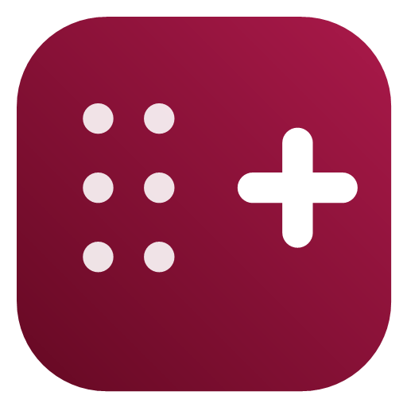
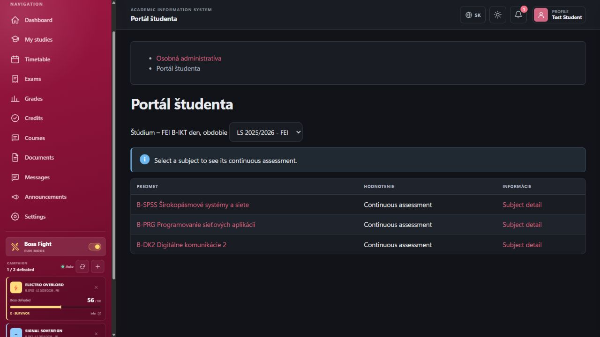
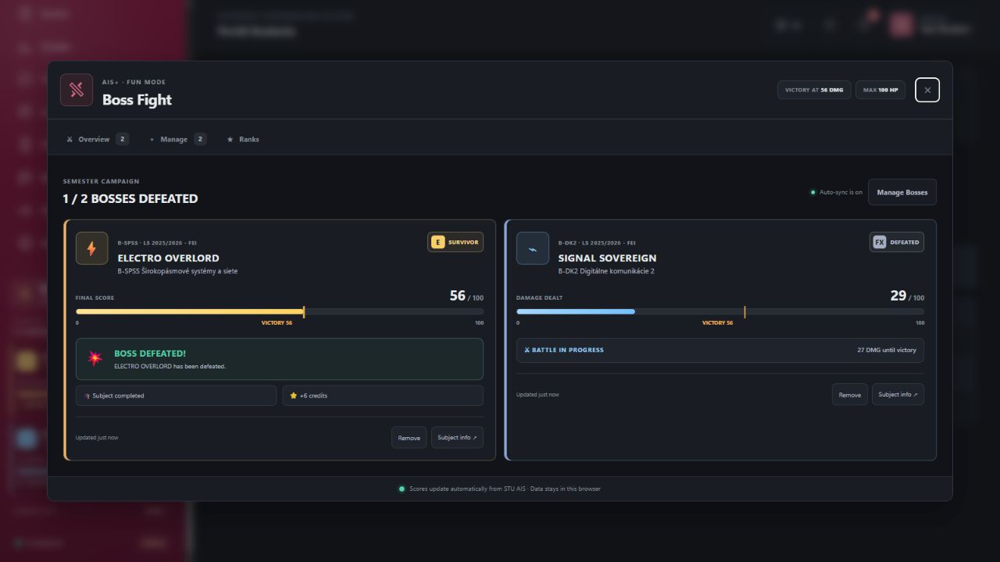
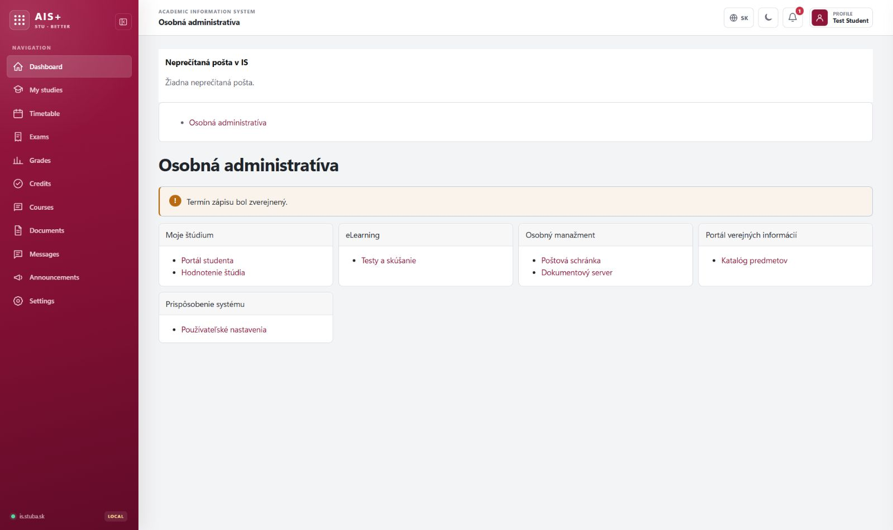
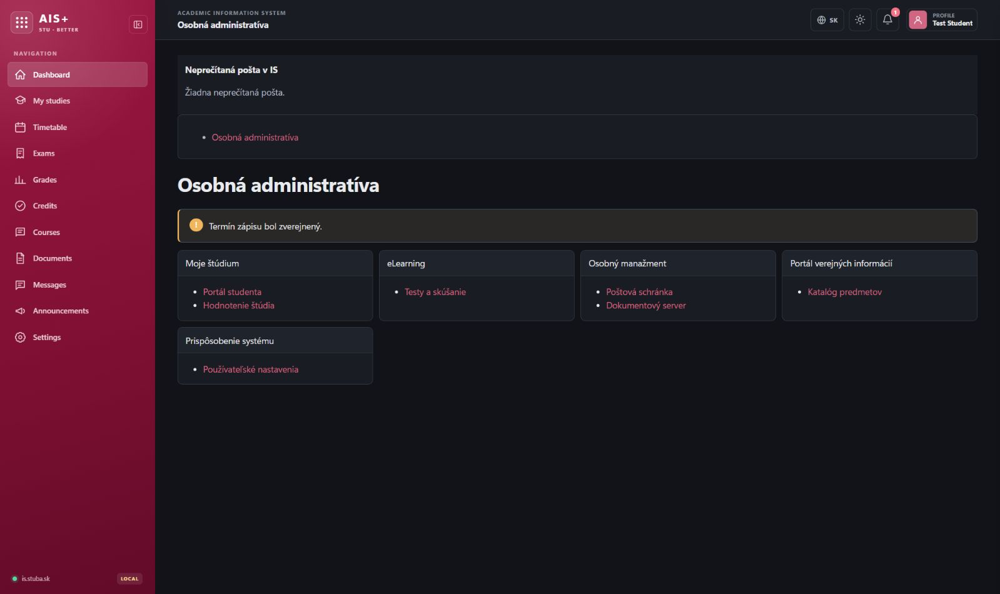

<div align="center">
  
  <h1>AIS+</h1>
  <p><strong>A better way to use STU AIS.</strong></p>
  <p>A modern, fast and private browser interface for the STU Academic Information System.</p>

  <p>
    <a href="https://github.com/antehor/AIS-/releases/latest"><strong>Download latest release</strong></a>
    ·
    <a href="#quick-install">Quick install</a>
    ·
    <a href="#slovenčina">Slovenčina</a>
    ·
    <a href="https://github.com/antehor/AIS-/issues">Report a problem</a>
  </p>

  <p>
    
    
    
    
  </p>
</div>

---

> **Experimental local build 2.2.0:** this working branch includes the optional Boss Fight fun mode
> with live sidebar progress and automatic score updates.
> It has not been published to GitHub Releases. See [Boss Fight documentation](docs/BOSS-FIGHT.md).

<details>
<summary><strong>Preview the experimental Boss Fight sidebar</strong></summary>





</details>

**AIS+** is an open-source browser extension and personal redesign for the
[Slovak University of Technology in Bratislava](https://www.stuba.sk/) Academic Information System at
`is.stuba.sk`. It keeps the real STU AIS pages, forms and data, while adding a clearer navigation,
light and dark themes, a compact layout and direct access to frequently used student tools.

If you searched for a **modern STU AIS interface**, **STU student portal redesign**,
**is.stuba.sk dark mode**, **STU timetable extension**, or a better UI for the
**Akademický informačný systém STU**, this is the project.



## Why AIS+

| Original workflow | AIS+ workflow |
|---|---|
| Important tools are spread across several menus | One persistent sidebar opens the relevant STU section |
| The interface is difficult to scan on large screens | Clear spacing, readable tables and responsive content |
| One fixed visual style | Light, dark and system themes |
| Navigation language can feel inconsistent | Stable panel language with English, Slovak and Czech controls |
| Frequent pages take several clicks | Multi-step navigation resolves the real links for the signed-in student |

## Features

- **Working student navigation** for My studies, Timetable, Exams, Grades, Credits, Courses,
  Documents, Messages, Announcements and Settings.
- **Collapsible sidebar** that remembers its state and becomes a mobile drawer on smaller screens.
- **English, Slovak and Czech** interface controls. The selected panel language stays unchanged
  while browsing between pages.
- **Light, dark and system themes**, plus an optional compact density.
- **Real STU functionality remains intact**: forms, links, sessions and server responses are not replaced.
- **Dynamic personal links**: timetable and study-plan URLs are read from the authenticated STU pages,
  so student identifiers are not hard-coded or published.
- **Private by design**: no analytics, external API, account access or data transmission.
- **Manifest V3**, with only `storage` permission and access limited to `https://is.stuba.sk/*`.
- **Optional Boss Fight experiment** with selected bosses in the sidebar and automatic SÚČET progress updates.

<details>
<summary><strong>Show the dark theme</strong></summary>



</details>

## Quick install

### Google Chrome

1. Download [`AIS-plus.zip`](https://github.com/antehor/AIS-/releases/latest) from the latest release.
2. Extract the archive to a permanent folder.
3. Open `chrome://extensions`.
4. Enable **Developer mode**.
5. Select **Load unpacked** and choose the extracted folder that contains `manifest.json`.
6. Open or reload [is.stuba.sk](https://is.stuba.sk/).

### Microsoft Edge

1. Download and extract the latest release.
2. Open `edge://extensions` and enable **Developer mode**.
3. Select **Load unpacked** and choose the folder containing `manifest.json`.
4. Open or reload [is.stuba.sk](https://is.stuba.sk/).

> The folder must stay in place after installation. For illustrated instructions, open
> [`INSTALL.html`](INSTALL.html) or read the [installation guide](docs/INSTALLATION.md).

<details>
<summary><strong>Install directly from the source code</strong></summary>

```bash
git clone git@github.com:antehor/AIS-.git AIS-plus
```

Then load the cloned `AIS-plus` directory as an unpacked extension. No build step and no package
manager are required.

</details>

## Using AIS+

- Click the **AIS+ extension icon** to enable or disable the redesign and select a theme or density.
- Use the **globe button** in the top bar to switch between `EN`, `SK` and `CZ`.
- Use the **panel button** beside the AIS+ logo to collapse or expand the sidebar.
- Personal destinations are resolved from the links available in your signed-in STU AIS session.
  If a destination lives inside the Student Portal, AIS+ opens that page and continues automatically.

## Updating

1. Download and extract the newer release over the existing AIS+ folder.
2. Open `chrome://extensions` or `edge://extensions`.
3. Press **Reload** on the AIS+ card, then refresh the STU AIS tab.

## Privacy and permissions

AIS+ runs locally in the browser. It stores interface preferences and, when Boss Fight is enabled,
the selected subject links plus the last score detected from STU AIS. It does not collect, sell or
send personal or academic data to any external service. See [PRIVACY.md](PRIVACY.md) for the full policy.

## Compatibility

| Browser | Status |
|---|---|
| Google Chrome (current) | Supported |
| Microsoft Edge (current) | Supported |
| Other Chromium browsers | Expected to work; not officially tested |
| Firefox | Not packaged yet |

## Slovenčina

<details open>
<summary><strong>AIS+ — modernejší Akademický informačný systém STU</strong></summary>

**AIS+** je open-source rozšírenie pre prehliadač a moderný redizajn
**Akademického informačného systému Slovenskej technickej univerzity v Bratislave** na
`is.stuba.sk`. Pôvodné stránky, formuláre a údaje STU zostávajú zachované; rozšírenie pridáva
prehľadnejšiu navigáciu, svetlú a tmavú tému, kompaktné zobrazenie a rýchly prístup k nástrojom študenta.

### Čo ponúka

- funkčný bočný panel pre **Moje štúdium, Rozvrh, Skúšky, Hodnotenie, Kredity, Predmety,
  Dokumenty, Správy, Oznamy a Nastavenia**;
- zbaliteľný panel s uloženým stavom a mobilným zobrazením;
- stále rozhranie v angličtine, slovenčine alebo češtine;
- svetlú, tmavú a systémovú tému;
- automatické vyhľadanie osobných odkazov priamo v prihlásenom STU AIS;
- žiadne sledovanie, analytiku ani odosielanie osobných údajov;
- iba oprávnenie na lokálne uloženie nastavení a prístup k `is.stuba.sk`.

### Rýchla inštalácia

1. Stiahnite ZIP z [najnovšieho vydania](https://github.com/antehor/AIS-/releases/latest) a rozbaľte ho.
2. V Chrome otvorte `chrome://extensions`; v Edge otvorte `edge://extensions`.
3. Zapnite **Režim pre vývojárov**.
4. Kliknite na **Načítať rozbalené** a vyberte priečinok s `manifest.json`.
5. Otvorte alebo obnovte [is.stuba.sk](https://is.stuba.sk/).

Podrobný návod je v súbore [docs/INSTALLATION.md](docs/INSTALLATION.md).

</details>

## Contributing and forks

Forks, fixes, translations and pull requests are welcome. Start with
[CONTRIBUTING.md](CONTRIBUTING.md). The project has no build step, so changes can be tested by
reloading the unpacked extension.

## Author

Created and maintained by **Yehor Halytskyi**.

- GitHub: [@antehor](https://github.com/antehor)
- LinkedIn: [Yehor Halytskyi](https://www.linkedin.com/in/yehor-halytskyi-392b92427/)

## License and project status

AIS+ is available under the [MIT License](LICENSE), so it can be used, modified and forked with
the copyright and license notice retained.

AIS+ is an independent community project and is not an official product of the Slovak University
of Technology in Bratislava. STU, AIS and related names remain the property of their respective owners.

<div align="center">
  <strong>AIS+</strong><br>
  <em>A better way to use STU AIS.</em>
</div>
